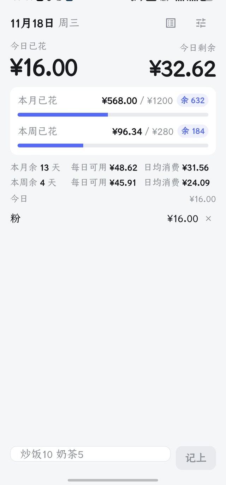
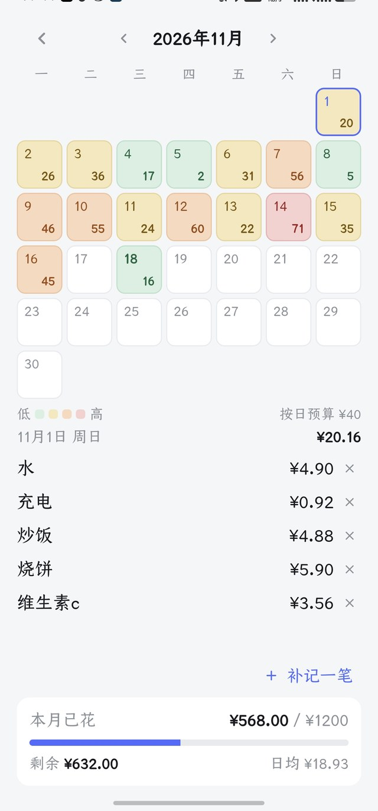
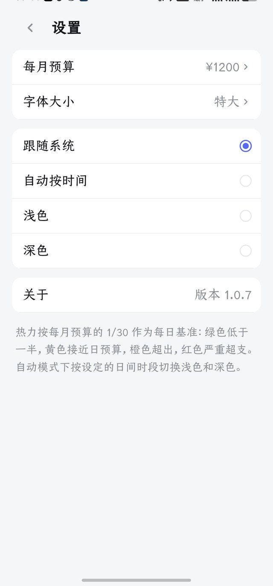

# 记账本 · Pocket Book

一句话记账的 Android 记账 App，用 Flutter 写的。打开就是输入框，打一行「炒饭10 奶茶5」回车就记完；首页显示今日已花和今天还能花多少，额度按月预算摊到每天，超支就变红。数据只存在手机本地，不联网、不需要账号。

| 今日 | 账单 | 设置 |
|:---:|:---:|:---:|
|  |  |  |

## 安装（Android）

**方式一：直接装 APK（推荐）**

1. 在仓库根目录下载 `pocket-book-1.0.7.apk`（点击文件名 → 右上角下载按钮，或 `git clone` 后取文件）
2. 把 APK 传到手机上：数据线拷到手机存储、或用微信 / QQ 传到「文件传输助手」再点开
3. 在手机上点击 APK 安装。首次会提示「不允许安装未知应用」，点「设置」→ 打开「允许来自此来源的应用」→ 返回继续安装
4. 装好打开即可用，不需要注册、不需要联网

如果微信里点开被拦，选「用其他应用打开」→「软件包安装程序」；小米 / OPPO / vivo 等机型可能还要在「安全中心」里再确认一次。

**方式二：自己编译**

```bash
flutter pub get
flutter build apk --release
# 产物：build/app/outputs/flutter-apk/app-release.apk
```

要求：Android 6.0 及以上；Dart SDK ≥ 3.13，Flutter 3。

> 数据全部存在手机本地 SQLite 里，换手机或卸载重装不会自动同步，卸载即清空。

## 功能

- **一句话批量记账**：空格、中英文逗号、顿号、分号、换行都能分隔，金额写在名称前后都行，纯数字记为「未命名」
- **额度实时算**：顶部显示今日已花 / 今日剩余；月度、周度两条进度条显示本月已花、本周已花，以及本月余几天、每日可用、日均消费
- **账单页日历**：按天显示花费热力（绿 / 黄 / 橙 / 红四档，基准是月预算 ÷ 30），点某天看明细，可往历史日期补记
- **本地存储**：sqflite 单机数据库，没有账号、没有网络请求
- **主题与字号**：跟随系统 / 按时间自动切换 / 浅色 / 深色，字体大小可调

## 技术

Flutter 3（Dart），sqflite 本地数据库，输入解析器自己写。

```
lib/
├── main.dart          入口、主题模式（跟随系统 / 按时间 / 浅色 / 深色）
├── parser.dart        一句话输入解析（「炒饭10 奶茶5」→ 两条记录）
├── models.dart        Entry / ParseItem
├── db.dart            sqflite 存取
├── app_state.dart     预算、当日 / 本周 / 本月统计、字号、状态通知
├── theme.dart         浅色 / 深色配色
└── pages/
    ├── today_page.dart     今日：输入、今日已花 / 剩余、月度与周度进度
    ├── bills_page.dart     账单：日历热力、当日明细、本月合计、补记
    └── settings_page.dart  设置：每月预算、字体大小、主题
```

## 其他文件

- `记账App-完整原型.html`：动手写 Flutter 之前的 HTML 原型，先跑通交互再实现
- `demo/`：原型演示视频（横屏 / 竖屏）、渲染与截图脚本

---

# Pocket Book (English)

A minimalist Android expense tracker built with Flutter. Open the app and you're already at the input box: type `炒饭10 奶茶5` (fried-rice 10, milk-tea 5) and both entries are recorded. The home screen shows today's spending and how much is left for today, derived from a monthly budget split across the days of the month — overspend turns red. Everything stays in a local SQLite database: no account, no network.

## Install (Android)

Download `pocket-book-1.0.7.apk` from the repository root, copy it to the phone, tap to install, and allow installing from unknown sources when prompted. Requirements: Android 6.0+. To build it yourself: `flutter pub get && flutter build apk --release`.

Data lives only on the device (SQLite); uninstalling clears it.

## Features

- **One-line batch entry** — split items by spaces, commas, enumeration marks or newlines; the amount can come before or after the name
- **Live allowance** — today's spending and remainder, plus monthly and weekly progress bars with days left, daily allowance and daily average
- **Bills calendar** — per-day heat colours (green / yellow / orange / red, benchmark = monthly budget ÷ 30), tap a day for details, back-dated entries
- **Local only** — sqflite on device, no accounts, no network calls
- **Themes & font size** — follow system / auto by time of day / light / dark, adjustable font scale

## Tech

Flutter 3 (Dart), sqflite, and a hand-written input parser. Structure: `lib/parser.dart` (text → entries), `lib/db.dart` (storage), `lib/app_state.dart` (budget & stats), `lib/pages/` (three screens). Tests in `test/layout_test.dart`.